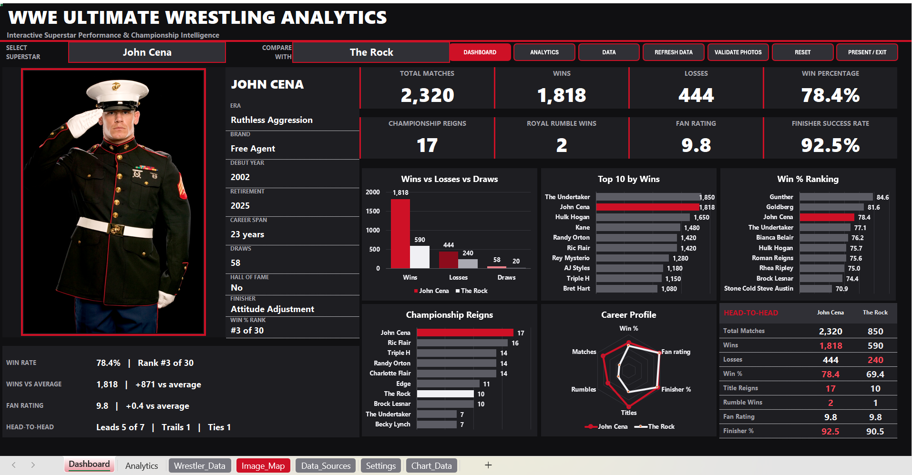
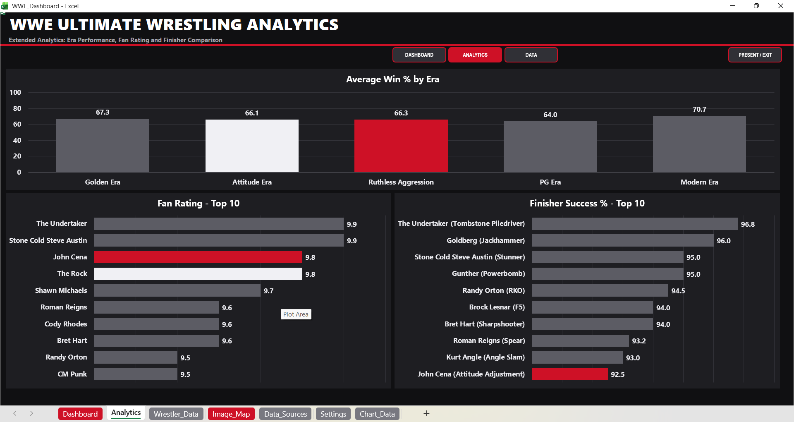

# 🤼 WWE Ultimate Wrestling Analytics Dashboard

An automated, executive-grade 16:9 interactive analytics engine built entirely inside Microsoft Excel using advanced VBA automation, dynamic image ingestion pipelines, and multi-metric performance benchmarking.

---

## 📌 Project Overview
This project transforms historical WWE superstar data into real-time visual performance intelligence. Built with an ultra-bold dark executive interface, it allows users to analyze individual superstar statistics, compare rivals head-to-head, and track championship metrics with automated VBA code execution.

> 🔒 **Security Notice:** The underlying Macro-enabled workbook (`.xlsm`) and VBA source code are retained privately to protect proprietary layout algorithms and automation logic. High-resolution interface previews and core operational workflows are demonstrated below.

---

## 🖼️ Dashboard Interface & Visual Previews

### 1. Main Executive Dashboard
- **Interactive Controls:** Superstar dropdown selector with automatic comparison pairing.
- **Dynamic Image Engine:** VBA-driven photo frame with automated binary verification and local caching.
- **KPI Metrics:** Total Matches, Win %, Titles Won, Royal Rumble Victories, Fan Rating, and Signature Finisher Success Rate.

---

### 2. Extended Performance Analytics
- **Rankings & Comparisons:** Top 10 Leaderboards across Wins, Win Percentages, Championships, and Fan Ratings.
- **Era & Radar Insights:** Multi-metric radar profiling and Era-wise win rate comparisons.

---

## 💡 Key Features & Technical Highlights

- **VBA Automation & Dynamic Layout:** Programmed automatic screen-fit zoom routines, presentation mode toggles, and window resize listeners.
- **Automated Image Caching Engine:** Built-in HTTP stream handler that validates image headers (JPEG/PNG), stores local copies, and updates superstar profiles dynamically upon selection.
- **Data Quality & Ingestion Audit:** Automated background parsing routines to handle missing metrics and validate historical datasets.
- **Head-to-Head Comparison:** Dual-series chart highlighting and radar profiling for side-by-side superstar evaluations.

---

## 🛠️ Tools & Technologies Used

- **Core Analytics:** Microsoft Excel (Advanced Formulas, Dynamic Array Functions, Pivot Analytics)
- **Automation Engine:** VBA (Visual Basic for Applications), WinHTTP API, ADODB Stream Handling
- **User Interface:** Dynamic 16:9 Canvas Layout, Custom Shapes, Dark Mode Executive Theme

---

## 👤 Author & Contact

- **Developer:** Mohamed Moufaq S
- **Role:** Data Science & Analytics Student
- **GitHub:** [github.com/Mohamedmoufaq](https://github.com/Mohamedmoufaq)
- **LinkedIn:** [linkedin.com/in/mohamed-moufaq147](https://linkedin.com/in/mohamed-moufaq147)
